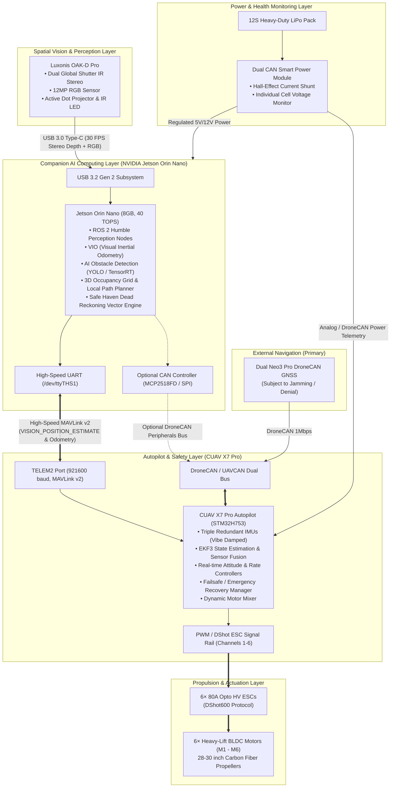
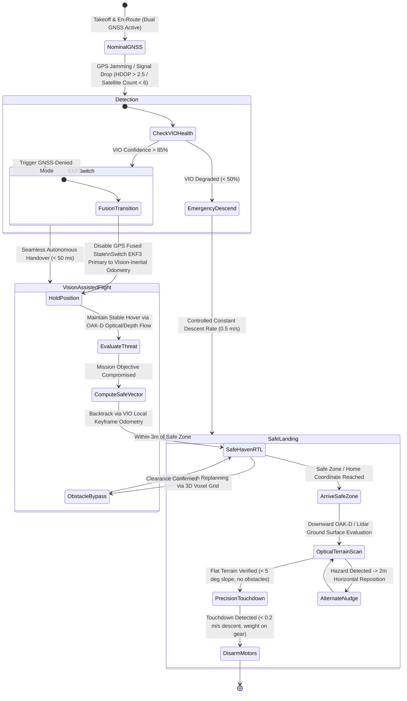

# INDIGENOUS HEXACOPTER – AI-ASSISTED GNSS-DENIED NAVIGATION
## CUAV X7 Pro + NVIDIA Jetson Orin Nano + Luxonis OAK-D Pro
**10-kg-Class Heavy-Lift Autonomous Unmanned Aerial System (UAS)**

---


---

## 1. System Engineering Overview

This engineering concept diagram and system architecture defines an indigenous, heavy-lift hexacopter capable of carrying a **10 kg payload** operating autonomously in **GNSS-denied environments** (e.g., electronic warfare jamming, spoofing, deep urban canyons, industrial hangars, or subterranean structures).

### Core Platform Specifications
| Specification | Engineering Rating / Value | Description |
| :--- | :--- | :--- |
| **Airframe Configuration** | Heavy-Lift Hexacopter (I6 Layout) | Toray 3K carbon-fiber arms & CNC aerospace aluminum hub |
| **Payload Capacity** | **10.0 kg nominal** (12.5 kg max) | Modular underslung payload bay with quick-release rail |
| **Maximum Takeoff Weight (MTOW)** | 28.5 kg | High thrust-to-weight ratio (2.1:1 thrust margin) |
| **Propulsion System** | 6× High-Efficiency Brushless BLDC Motors | 100KV–120KV outrunners with 28–30" carbon folding props |
| **Electronic Speed Controllers** | 6× 80A HV ESCs | DShot600 / Telemetry feedback (RPM, temp, voltage) |
| **Primary Flight Controller (FC)** | **CUAV X7 Pro** | Triple-redundant IMU with internal temperature/vibration damping |
| **Companion AI Computer (CC)** | **NVIDIA Jetson Orin Nano (8GB)** | 40 TOPS AI compute running ROS 2 Humble & Isaac ROS |
| **Spatial Perception Sensor** | **Luxonis OAK-D Pro** | Active IR stereo depth + 12MP RGB + on-chip Myriad X/RVC2 VPU |
| **Power Plant** | 12S (44.4V) 22,000–30,000 mAh LiPo/Solid-State | Dual redundant CAN power distribution & battery monitoring |

---

## 2. Onboard Avionic & Interconnect Architecture



---

## 3. Detailed Hardware Interconnect & Pinout Specification

### A. Luxonis OAK-D Pro to NVIDIA Jetson Orin Nano
- **Physical Link**: Industrial-grade locking USB 3.2 Gen 2 Type-C to Type-A cable.
- **Data Streams**:
  - Stereo Depth Map (800p @ 30 FPS, active IR pattern illumination for low-light/textureless environments).
  - High-Resolution RGB Stream (1080p @ 30 FPS or 4K @ 15 FPS).
  - Spatial AI Detections: On-chip neural inference bounding boxes with 3D coordinates \([X, Y, Z]\).
  - Integrated 6-Axis BNO086 IMU motion data via DepthAI pipeline.

### B. NVIDIA Jetson Orin Nano to CUAV X7 Pro Autopilot
- **Primary Data Link (UART Telemetry)**:
  - **Jetson Side**: UART1 (`/dev/ttyTHS1`) on 40-pin expansion header (Pin 8: TXD, Pin 10: RXD, Pin 6: GND).
  - **CUAV X7 Pro Side**: `TELEM2` port with JST-GH 6-pin connector.
  - **Baud Rate**: **921,600 baud** with hardware RTS/CTS flow control.
  - **Protocol**: **MAVLink v2** delivering high-frequency `VISION_POSITION_ESTIMATE` (50 Hz), `ODOMETRY` (30 Hz), and `OBSTACLE_DISTANCE` (15 Hz).
- **Secondary / Optional Link (DroneCAN / UAVCAN)**:
  - SPI-to-CAN transceiver on Jetson connecting directly to the CUAV dual CAN bus (`CAN1` / `CAN2`).
  - Transmits deterministic status frames, hardware health beacons, and high-priority trajectory override frames.

### C. CUAV X7 Pro to 6× ESCs & Brushless Motors
- **Physical Link**: JST-GH 8-pin Main Out & Aux Out harnesses routed through anti-vibration carbon conduits.
- **Signaling Protocol**: **DShot600** bidirectional digital telemetry or PWM (400 Hz fallback).
- **Actuation Mapping**:
  - M1: Front-Right (CCW) | M2: Right (CW) | M3: Rear-Right (CCW)
  - M4: Rear-Left (CW) | M5: Left (CCW) | M6: Front-Left (CW)

---

## 4. Software & Autonomous Processing Division

```
+-----------------------------------------------------------------------------+
|                  NVIDIA JETSON ORIN NANO (Companion Computer)               |
|                                                                             |
|  [ Luxonis OAK-D Pro DepthAI ]                                              |
|             |                                                               |
|             v                                                               |
|  [ Isaac ROS Visual Odometry (VIO) / ORB-SLAM3 ]                            |
|             |                                                               |
|             +---> 6-DOF Local Pose & Velocity Estimation (30 Hz)            |
|             |                                                               |
|  [ YOLOv8 / TensorRT Obstacle & Hazard Detection ]                          |
|             |                                                               |
|             +---> 3D OctoMap / Voxel Grid Collision Avoidance (20 Hz)        |
|             |                                                               |
|  [ Local Path Planner & Safe-Haven Trajectory Recovery Engine ]             |
|             |                                                               |
|             v                                                               |
|  [ MAVROS / MAVLink Bridge ] =====> Sends VISION_POSITION_ESTIMATE to FC   |
+-----------------------------------------------------------------------------+
                                      ||  High-Speed UART (921600 Baud)
                                      \/
+-----------------------------------------------------------------------------+
|                       CUAV X7 PRO (Real-Time Autopilot)                    |
|                                                                             |
|  [ Triple IMU Sensor Fusion - EKF3 Engine ]                                 |
|             |                                                               |
|             +---> Dynamic State Estimation (Attitude, Position, Vel)        |
|             |                                                               |
|  [ Multi-Sensor Health & GPS Signal Quality Monitor ]                       |
|             |                                                               |
|             +---> GPS Loss / Spoofing Detection Trigger                    |
|             |                                                               |
|  [ Real-Time Attitude & Position PID Controllers (400 Hz) ]                 |
|             |                                                               |
|  [ Flight Mode Executive & Fail-safe State Machine ]                        |
|             |                                                               |
|             v                                                               |
|  [ Motor Mixer & DShot600 Drivers ] =====> Commands to 6× Motors (M1 - M6)  |
+-----------------------------------------------------------------------------+
```

---

## 5. GNSS-Denied Safe Recovery Logic & Failover Workflow

When operating in field environments, GNSS signals can degrade abruptly due to jamming, multipath reflection, or RF denial. The indigenous architecture executes a deterministic, multi-stage recovery protocol:



### Key Safety Guarantees During GNSS Loss:
1. **Zero-Latency Handover**: The EKF3 algorithm running on the CUAV X7 Pro continuously subscribes to visual odometry streams from the Jetson Orin Nano in parallel with GNSS. When GPS integrity drops below threshold, the estimator switches primary position reference to VIO without intermediate altitude drops or attitude destabilization.
2. **Reverse Odometry Backtracking**: The Jetson stores high-confidence visual keyframes in a topological navigation graph. If global positioning fails, the drone retraces its verified ingress corridor back toward the predefined launch/safe-haven perimeter.
3. **Active Hazard Avoidance**: The Luxonis OAK-D Pro's onboard active IR flood and structured laser dot projector allow depth perception even in pitch-black interiors or shadowy environments, preventing collisions with wires, structures, and tree branches during recovery.

---

## 6. Power Architecture & Battery Fail-Safe Matrix

The power system features dual CAN-based smart telemetry power bricks monitoring the heavy-lift 12S battery bank.

```
                   12S LiPo Main Power Bank (44.4V Nominal)
                                      |
                                      v
                 [ CUAV CAN PMU / Smart Shunt Sensor ]
                     |                           |
        +------------+                           +------------+
        |                                                     |
High-Current VCC (44.4V)                             Dual Regulated 5.3V / 12V
        |                                                     |
        v                                                     v
  6× 80A Motor ESCs                              Avionics Isolated Power Hub
  (M1 to M6 Propulsion)                          - CUAV X7 Pro (Dual Power In)
                                                 - NVIDIA Jetson Orin Nano (12V/5A)
                                                 - Luxonis OAK-D Pro (via Jetson USB)
```

### Safety Threshold Actions
| Battery Level | Condition | Autopilot Autonomous Action |
| :--- | :--- | :--- |
| **Stage 1 Warning** | Cell voltage \(\le 3.65\text{ V}\) (25% SoC) | Companion computer recalculates energy-to-home. Issues mission abort recommendation to ground station; begins conservative speed profile. |
| **Stage 2 Critical** | Cell voltage \(\le 3.50\text{ V}\) (15% SoC) | Autonomous Return-to-Safe-Haven (RTSH) triggered immediately via visual odometry route. Non-essential AI pipelines throttled to conserve power. |
| **Stage 3 Emergency** | Cell voltage \(\le 3.35\text{ V}\) (5% SoC) | Immediate controlled vertical descent at current coordinates. OAK-D Pro depth camera activates terrain slope scanning to perform safe touchdown. |

---

## 7. Indigenous Heavy-Lift 10 kg Drone Bill of Materials (BOM)

| Subsystem | Component Name | Function / Specification |
| :--- | :--- | :--- |
| **Flight Control** | CUAV X7 Pro Autopilot | Triple IMU, STM32H753, shock-isolated, dual CAN, 8× PWM/DShot |
| **Companion Computer** | NVIDIA Jetson Orin Nano Dev Kit (8GB) | 40 TOPS AI inference, Ubuntu 22.04 + ROS 2 Humble |
| **Stereo Depth Vision** | Luxonis OAK-D Pro | Active IR stereo depth, 12MP RGB, onboard neural processing |
| **Frame** | Indigenous 1200mm Hexacopter Frame | 35mm carbon-fiber arms, titanium fasteners, CNC motor mounts |
| **Motors** | 6× 100KV High-Efficiency Brushless | Rated for 5.5 kg thrust per axis (total 33 kg thrust at full throttle) |
| **Propellers** | 6× 28×9.2" Foldable Carbon Fiber | Low noise, aerodynamically balanced for high payload stability |
| **ESCs** | 6× 80A 12S Opto DShot600 | High refresh rate, regenerative braking, active freewheeling |
| **Power Management**| CUAV CAN PMU | 12S high-precision voltage/current sensing with DroneCAN |
| **Connectivity** | High-Speed Industrial USB-C & JST-GH | Locking vibration-resistant connectors with shielded cabling |

---
*Document Ref: UAS-IND-HX10-ARCH-2026*  
*Classification: Professional Engineering Concept & Autonomous Architecture*
